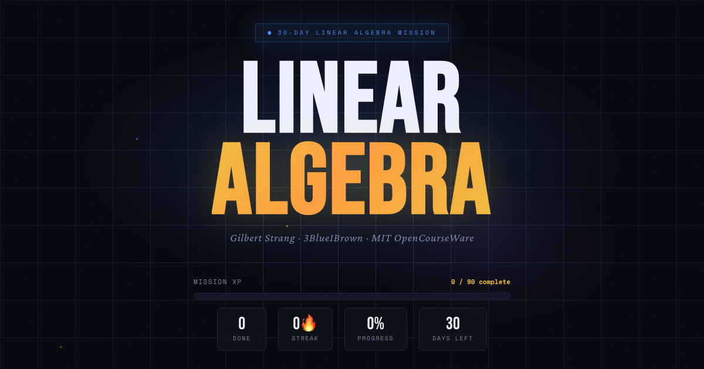
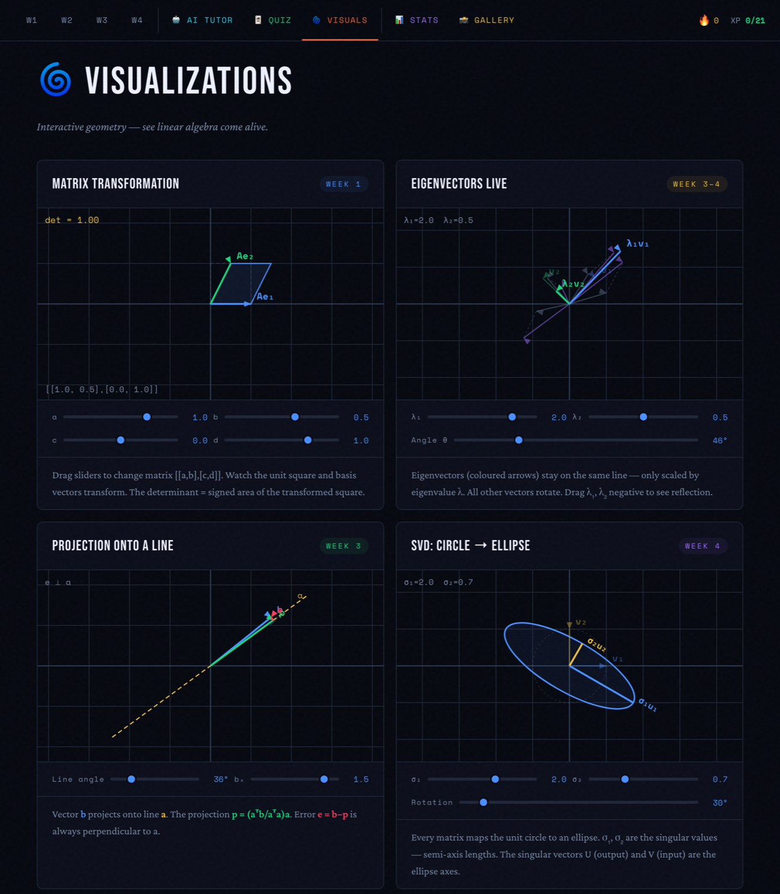

# Linear Algebra · Mission Control

[](https://whynot-luo.github.io/linear-algebra-mission-control/)
[](LICENSE)
[](#architecture)

**[Open the live site →](https://whynot-luo.github.io/linear-algebra-mission-control/)**

A browser-based study tool that turns MIT's **18.06 Linear Algebra** into a structured 30-day plan. Each day pairs a 3Blue1Brown video with the matching Gilbert Strang lecture and its problem set, then adds flashcards, quizzes, and four interactive visualizations built on `<canvas>`.

No framework, no build step, no backend — 2,000 lines of plain HTML, CSS and JavaScript, served as static files.



---

## Why this exists

MIT OpenCourseWare publishes everything you need to learn linear algebra, but it is awkward to actually study from:

- **The lectures and the problem sets live on separate pages**, and their numbering does not line up. OCW's session `1-2` is *Elimination with Matrices*, which belongs to Lecture 2 — but a naive reading pairs it with Lecture 1. Get this wrong and you spend a week solving problems on a topic you have not watched yet.
- **3Blue1Brown's *Essence of Linear Algebra*** is the best geometric introduction available, but it is a separate playlist in a different order from Strang's.
- **Nothing tracks what you have done**, so motivation leaks away around day four.

This project resolves the pairing once, fixes it in data, and wraps it in something that makes progress visible.

## Features

### The 30-day plan
- **4 weeks, 30 days, 90 tasks.** Every day holds exactly three, in the order they should be done: watch, study, then stretch.
- **Three kinds of task**, colour-coded: `3B1B` (geometric intuition first), `MIT` (a Strang lecture plus its matched OCW problem set and solutions), and `CHALLENGE` (harder problems from the MIT 18.06 Spring 2022 exams and psets).
- **Verified pairings.** All 36 problem-set entries point at the OCW session that actually belongs to that day's lecture, and all 108 external links resolve.
- **23 concept summaries** with the geometric picture, the key formula, and the mistake students usually make.
- **A sketch prompt on all 30 days** — linear algebra is learned by drawing it, so each day names one specific thing to draw by hand.

### Tracking
- Per-task checkboxes, an XP bar, and per-week progress bars
- A day-streak counter that only advances when you actually complete a task
- A 30-day calendar heat grid and a stats page
- Autosaving notes per day
- Photo uploads for hand-drawn sketches, with a gallery view

### Study tools
- **21 flashcards** and **8 multiple-choice questions**, filterable by week, with a real Fisher–Yates shuffle and a running score
- **Four interactive visualizations**, each driven by live sliders:
  - *Matrix transformation* — watch the unit square and basis vectors deform, with the determinant as signed area
  - *Eigenvectors* — eigenvectors hold their line while every other vector swings off it
  - *Projection onto a line* — `p = (aᵀb/aᵀa)a`, with the error `e = b − p` meeting the line at a right angle
  - *SVD* — the unit circle becoming an ellipse whose semi-axes are the singular values
- **An optional AI tutor** powered by DeepSeek (see below)



---

## Design decisions worth explaining

These are the parts of the project that required a judgement call rather than just typing.

### A static site cannot hold a secret

GitHub Pages serves files, nothing more. There is no server to keep an API key on, and anything shipped in the source is readable by every visitor. So the tutor is **bring-your-own-key**: each visitor pastes their own DeepSeek key, it is stored only in their browser's `localStorage`, and it is sent only to `api.deepseek.com`. No key of mine is in this repository, and none ever will be.

A consequence worth handling: a key pasted for the *wrong provider* must never be forwarded to DeepSeek. The input rejects known foreign prefixes by name — `sk-ant-` (Anthropic), `sk-or-` (OpenRouter), `gsk_` (Groq), `AIza` (Google) — rather than silently sending someone's Anthropic key to a different company. When the project switched providers, the old storage key was also cleared on load for the same reason.

### Browser storage has a hard ceiling

Everything persists to `localStorage`, which caps out around 5 MB. A single phone photo can exceed that on its own. Uploads are therefore decoded, scaled to a maximum edge of 1280 px, flattened onto white and re-encoded as JPEG at quality 0.82 before they are stored — turning a multi-megabyte photo into tens of kilobytes. If a write still fails, the app says so rather than losing the photo quietly, and the whole storage layer falls back to memory when `localStorage` is blocked entirely, as in private browsing.

### Canvases must be sized for the device, not the layout

A `<canvas>` has a CSS size and a separate backing-store size. Setting only the former gives blurry output on any retina display. Each visualization sizes its backing store to `devicePixelRatio` and then scales the drawing context, so the drawing code keeps working in CSS pixels while the output stays sharp.

### A streak should measure work, not visits

The obvious implementation advances the counter whenever the app loads on a new day. That rewards opening a tab. Here the streak advances only from the task-completion handler, at most once per day, and a streak not continued today or yesterday displays as zero without overwriting the stored value.

---

## Architecture

```
index.html            page markup and all page sections
css/style.css         all styles; design tokens are CSS variables at the top
js/storage.js         localStorage wrapper with an in-memory fallback
js/curriculum.js      the 30-day plan: days, tasks, resource links, concept summaries
js/quiz-data.js       flashcards and multiple-choice questions
js/app.js             state, week/day rendering, stats, gallery, navigation
js/tutor.js           AI tutor (bring-your-own-key)
js/quiz.js            flashcard and quiz engine
js/visuals.js         the four canvas visualizations
js/main.js            startup wiring
assets/               favicon and preview images
```

Plain HTML, CSS and JavaScript with no dependencies, no bundler and no transpiler. The scripts are classic `<script defer>` files sharing one global scope, loaded in the order listed in `index.html` — data files first, then the modules that read them, then `main.js`, which wires up the DOM on `DOMContentLoaded`.

Content and behaviour are kept apart: the entire curriculum lives in `js/curriculum.js` as data, so adding a day or re-pointing a link never means touching rendering code.

## Running it locally

Any static file server works:

```bash
python3 -m http.server 8000
```

Then open <http://localhost:8000>.

Opening `index.html` straight from disk also renders the tracker, quiz and visualizations. The AI tutor has only been tested over `http(s)`.

## Deploying

The site is deployed from this repository with no build step:

1. Push to GitHub.
2. **Settings → Pages → Source:** *Deploy from a branch*, branch `main`, folder `/ (root)`.
3. The site is served at `https://<user>.github.io/<repo>/`.

## The AI tutor

An optional tab that answers linear algebra questions with a system prompt tuned for geometric intuition and Strang's row/column picture framing.

| Setting | Value |
|---|---|
| Endpoint | `https://api.deepseek.com/chat/completions` |
| Model | `deepseek-chat` |
| Configured in | [`js/tutor.js`](js/tutor.js) (`AI_MODEL`, `AI_ENDPOINT`, `AI_TEMPERATURE`) |
| Key storage | `localStorage`, key `la30_deepseek_key`, this browser only |
| History sent | last 20 turns |

To use it, get a key at [platform.deepseek.com](https://platform.deepseek.com/api_keys) and paste it into the tutor tab. DeepSeek accounts are prepaid, so keep only a small balance on a key used this way, and press **Remove key** when finished on a shared machine. Without a key the rest of the site works normally.

DeepSeek speaks the OpenAI chat-completions dialect, so switching to another OpenAI-compatible provider means changing `AI_ENDPOINT` and `AI_MODEL` and nothing else.

## Your data

Everything you do — completed tasks, notes, streak, uploaded photos, API key — stays in your browser's `localStorage` on that one device. Nothing is uploaded, there are no accounts, and the site contains no analytics or tracking code. Clearing site data resets the tracker.

For completeness, the page does make two kinds of third-party request: web fonts from Google Fonts on every load, and — only once you have added a key — the tutor's calls to `api.deepseek.com`. Self-hosting the fonts would remove the first.

Keys used: `la30_tasks`, `la30_notes`, `la30_streak`, `la30_uploads`, `la30_deepseek_key`.

## Accessibility

Day cards, task checkboxes, flashcards and quiz options are operable by keyboard with the matching ARIA state; the page has a skip link, visible focus outlines, labelled canvases and sliders, and honours `prefers-reduced-motion`.

## Known limitations

- **Browser coverage.** Developed and tested in Chromium-based browsers. Safari and Firefox are untested.
- **No sync.** Progress is per-browser and per-device by design; there is no account system, so it does not follow you to another machine.
- **The tutor needs the visitor's own key** and a prepaid DeepSeek balance. If the balance runs out the tutor reports it cleanly, but it stops answering.
- **Multiple choice allows skipping.** Pressing *Next* without answering advances without scoring, so a session with skipped questions reports a higher percentage than it should.

## Credits

The curriculum links to material owned by others; this project reproduces none of it beyond short original summaries.

- [MIT OpenCourseWare 18.06SC Linear Algebra](https://ocw.mit.edu/courses/18-06sc-linear-algebra-fall-2011/) by Gilbert Strang (CC BY-NC-SA 4.0), and the [MIT 18.06 Spring 2022 course site](https://web.mit.edu/18.06/www/Spring2022/) for exams and problem sets
- [Essence of Linear Algebra](https://www.3blue1brown.com/topics/linear-algebra) by Grant Sanderson (3Blue1Brown)

Section numbers such as §2.6 refer to Strang's *Introduction to Linear Algebra*, 5th edition.

This is an independent study tool and is not affiliated with MIT or 3Blue1Brown.

## License

[MIT](LICENSE) for the code in this repository.
